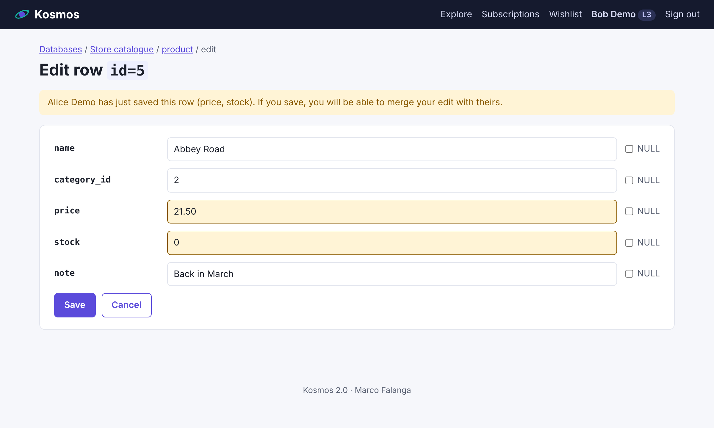
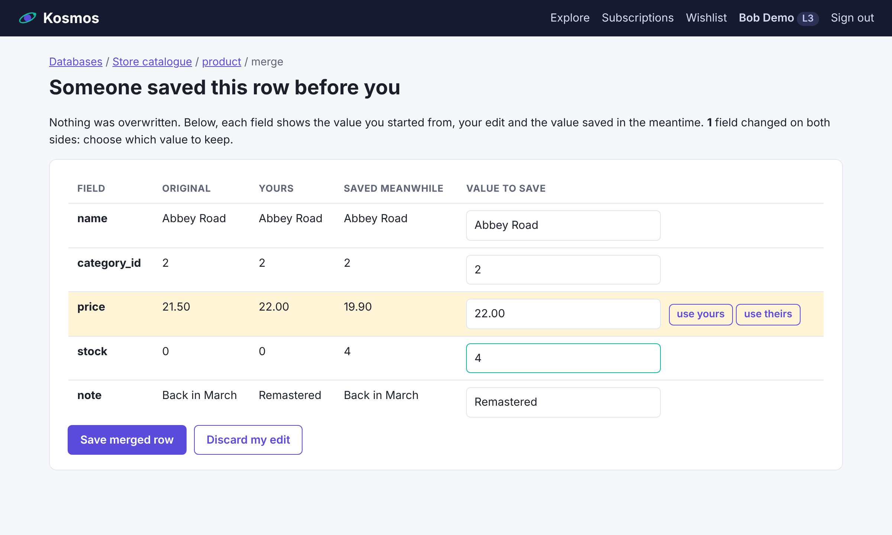
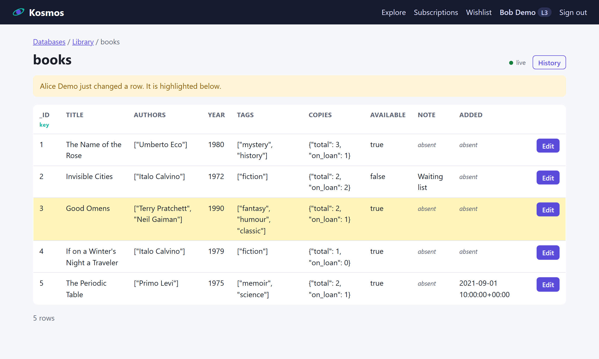
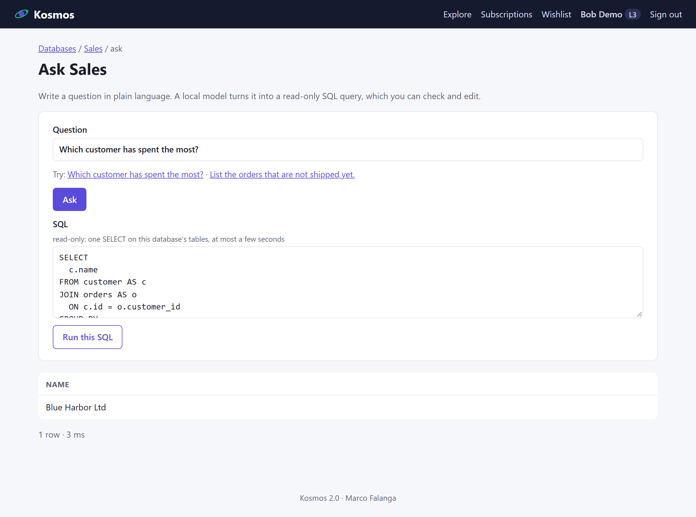

# Kosmos 2.0: safe live editing of shared databases

<p class="project-meta">Personal projects · 2026-11</p>

<span class="tag">Python</span> <span class="tag">FastAPI</span> <span class="tag">SQLAlchemy</span> <span class="tag">PostgreSQL</span> <span class="tag">MariaDB</span> <span class="tag">MongoDB</span> <span class="tag">Docker</span> <span class="tag">Qwen2.5</span> <span class="tag">concurrency</span> <span class="tag">optimistic locking</span> <span class="tag">Server-Sent Events</span> <span class="tag">text-to-SQL</span>

!!! note ""
    The source code is private; get in touch to request access.

Kosmos lets a group of people browse and edit shared databases from the browser at the same time, without
overwriting each other's work. Every saved change appears live on everyone's screen. If two people edit the same
row, the second save is stopped and turned into a merge instead of silently replacing the first.

The project was run as a redesign study around one question: what does it take for concurrent edits to be
safe, not just visible? The results below compare the Kosmos save with the approach without the improvements
(read the row, then write whatever the user submitted) on three database engines.

## See it in action

<video class="demo-video" src="media/demo.webm" autoplay loop muted playsinline controls></video>

Two users, Alice and Bob, on two different computers. First Alice saves a row and Bob's table updates by itself.
Then both open the same row: Alice saves a new price, Bob is warned straight away, and when he saves his note
anyway, Kosmos merges the two edits instead of letting one overwrite the other. Recorded on the demo databases
that come with the project.

## Highlights

- **Any MariaDB/MySQL, PostgreSQL or MongoDB database.** An administrator adds a connection and Kosmos reads its
  tables and columns (or collections and fields), so a new database needs no code changes. Connection passwords
  are stored encrypted.
- **Live updates.** Saved changes are pushed to every open page with Server-Sent Events, through PostgreSQL
  `LISTEN/NOTIFY`, so they work across several server processes. Changed rows update in place and are highlighted.
- **Safe concurrent edits.** A save only applies if the row is still as the user saw it. Otherwise nothing is
  overwritten: Kosmos shows the original, your edit and theirs, merges the fields that don't clash and lets you
  pick a value for those that do.
- **History and revert.** Every change is recorded with who, when, and the values before and after. A revert is
  refused if the row has changed since.
- **Questions in plain language.** A local model on Ollama turns a question into SQL, which is checked so that it
  can only read, then run in a read-only transaction with a time limit. The query is always shown and editable.
- **Accounts and access levels**, with each database visible only from a minimum level.
- **99 automated tests**: unit, app, MongoDB, plain-language questions, and two real browsers editing the same
  row. They pass on Linux and Windows.

| An edit page warns as soon as someone else saves the row | The merge page after a concurrent save |
|---|---|
|  |  |

## How it works

```
Browser: Alice        Browser: Bob
      │  HTML forms + live events  │
      └─────────────┬──────────────┘
                    ▼
FastAPI app      pages, tables, admin
(1+ workers)
                    │
                    ▼
Editing          optimistic save, merge,
                 audit log, broadcast
      │                          │
      ▼                          ▼
Shared databases          Kosmos database
MariaDB / PostgreSQL /    (PostgreSQL): users,
MongoDB                   connections, audit,
                          LISTEN/NOTIFY events
```

**The optimistic save.** When you open a row, the page keeps the values you started from (`base`). Saving runs a
single statement:

```sql
UPDATE product SET price = :new_price
WHERE id = :id
  AND name IS NOT DISTINCT FROM :base_name      -- one check per editable column,
  AND price IS NOT DISTINCT FROM :base_price    -- NULL-safe
  AND ...
```

If it matches one row, the save happened and the change is logged and broadcast. If it matches none, the row
changed (or was deleted) in the meantime: Kosmos reads the current row and runs a three-way merge between `base`,
your values and the current values. No locks are held while people edit, so readers and writers never block each
other.

**MongoDB collections** appear as tables, keyed by `_id`. Numbers, booleans, arrays and sub-documents are edited
as JSON and keep their type. The same rule applies to the whole document: the update only matches if nobody
changed any field, nested and newly added ones included.



## Results: lost updates under concurrency

N editors save the same row at the same time, 100 times each: read the counter, pause for up to 2 ms like a person
editing, write the value + 1. After 100 × N saves the counter should equal 100 × N.

| Editors | Saves | Lost, approach without the improvements (MariaDB / PostgreSQL / MongoDB) | Lost, Kosmos save |
|---:|---:|---|---|
| 2 | 200 | 96 (48%) / 94 (47%) / 96 (48%) | **0 / 0 / 0** |
| 4 | 400 | 280 (70%) / 289 (72%) / 293 (73%) | **0 / 0 / 0** |
| 8 | 800 | 667 (83%) / 676 (84%) / 660 (82%) | **0 / 0 / 0** |
| 16 | 1,600 | 1,474 (92%) / 1,478 (92%) / 1,438 (90%) | **0 / 0 / 0** |

The plain read-then-write loses about half of the edits with only two editors and almost all of them with
sixteen, with no error shown to anyone. The Kosmos save loses none: every clash is detected and, in the app, shown
to the user as a merge. This is a worst case, since every editor hits the same row with almost no pause.

## Results: plain-language questions



23 questions on the demo databases, run 3 times each with qwen2.5:7b-instruct on a local GPU. An answer counts as
correct when its query passes the safety check, runs read-only, and returns the same values as a hand-written
reference.

| Correct | Unsafe requests refused | Median time per question |
|---:|---:|---:|
| **69/69** | 9/9 | 2.3 s |

The unsafe requests ask to change data or read the server's user accounts. The set is small and the demo schemas
are simple, so this shows that the pipeline works end to end, not how a 7B model does on large, messy schemas.

## Stack

Python 3.12 · FastAPI · SQLAlchemy 2 · PyMongo · PostgreSQL · MariaDB · MongoDB · Server-Sent Events · sqlglot ·
Ollama (Qwen2.5 7B) · Docker Compose · pytest · Playwright · uv

## Origin

Kosmos 2.0 is the rebuild of my bachelor thesis project (Kosmos, PHP and MySQL, 2021) in Python and FastAPI.
