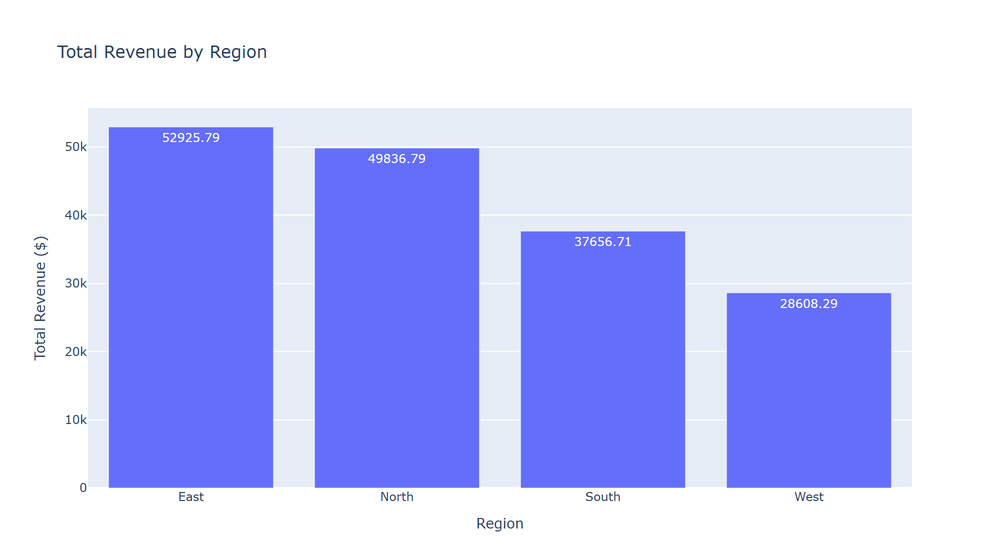
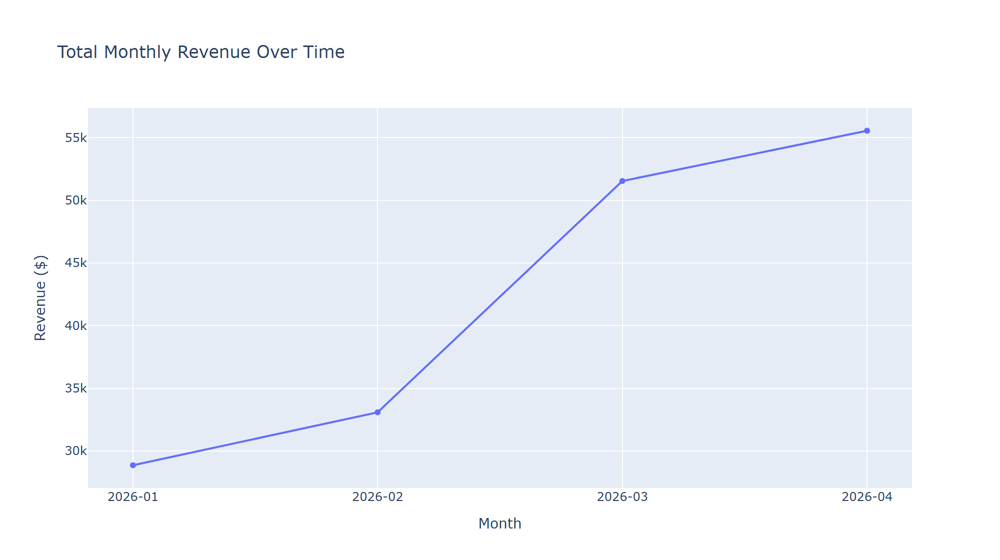

# Chiron: a data-analysis agent as a service

<p class="project-meta">Technical assignments · 2026-10</p>

<span class="tag">Python</span> <span class="tag">FastAPI</span> <span class="tag">SQLite</span> <span class="tag">Plotly</span> <span class="tag">Docker</span> <span class="tag">pytest</span> <span class="tag">LLM agents</span> <span class="tag">ReAct</span> <span class="tag">sandboxing</span> <span class="tag">hexagonal architecture</span>

!!! note ""
    The source code is private; get in touch to request access.

You upload a CSV and ask a question in plain language, for example *"Which region earns the most? Show a chart."*
An agent plans, writes Python, runs it in a locked-down process, reads the real output and iterates until it can
answer. The HTTP API returns the answer, an interactive Plotly chart and every step of the reasoning. Sessions are
stored, so a follow-up like *"and which product sells best in that region?"* is understood in context, even after a
restart.

Built as a technical assignment: a complete, tested and containerised service, not a notebook.

## Highlights

- **Agent loop written from scratch** (~170 lines, ReAct: plan, act, observe). No framework, so retries, parse
  recovery and the step budget are explicit and unit-tested. A malformed model reply is fed back as an error, never
  accepted as an answer.
- **Sandbox for generated code**: a fresh process per run with CPU, memory and file-size limits, a scrubbed
  environment, and a Python audit hook that blocks file access outside a temp folder, network, subprocesses and native
  code. A violation kills the process. The container adds the real boundary: non-root, read-only filesystem, no
  capabilities.
- **Hexagonal architecture**: the agent core is plain Python and knows nothing about HTTP, the database or the model
  vendor. A test parses the source tree and fails if that rule is broken. Any OpenAI-compatible model works (Gemini by
  default).
- **About 150 automated tests**: the agent runs against a scripted model (including broken replies and outages), the
  sandbox is attacked for real (memory bombs, `/etc/passwd`, symlinks, `_socket`, fork), and a Docker smoke test checks
  the built image.
- **Robust by design**: retries with backoff on model errors, a concurrency cap that answers `429` instead of running
  out of memory, structured JSON logs with request ids, and every step of every turn saved as it happens.
- **41 documented design decisions**, each with the alternatives considered and the trade-off accepted.

## Demo: one conversation

<video class="demo-video" src="media/demo.webm" autoplay loop muted playsinline controls></video>

The video replays a real session recorded through the HTTP API with Gemini:
the thoughts, code, outputs, answers and charts are exactly what the service returned. It ran on a small sales CSV (four regions, three products, January to April). The three questions are asked in the same session, so "that region" in the second one is resolved from the first answer. Every figure below was checked against the CSV with pandas.

### 1. "Which region earns the most? Show a chart."

<details markdown>
<summary>How the agent got there (2 steps)</summary>

**Step 1, run code.** *Aggregate revenue by region to determine which earns the most, and generate a plotly chart saved as plot.html.*

```python
import pandas as pd
import plotly.express as px

df = pd.read_csv('data.csv')
region_revenue = df.groupby('region', as_index=False)['revenue'].sum().sort_values(by='revenue', ascending=False)
print(region_revenue)

fig = px.bar(
    region_revenue,
    x='region',
    y='revenue',
    title='Total Revenue by Region',
    labels={'region': 'Region', 'revenue': 'Total Revenue ($)'},
    text_auto='.2f'
)
fig.write_html("plot.html", include_plotlyjs="cdn")
print("Chart saved as plot.html")
```

Output:

```text
region   revenue
0   East  52925.79
1  North  49836.79
2  South  37656.71
3   West  28608.29
Chart saved as plot.html
```

**Step 2, final answer.** *The output clearly shows that the East region earns the most revenue ($52,925.79), followed by North ($49,836.79), South ($37,656.71), and West ($28,608.29). The chart has been saved as plot.html. I can now provide the final answer.*

</details>

> The **East** region earns the most, with a total revenue of **$52,925.79**. 
>
> Here is the breakdown by region:
>
> - **East:** $52,925.79
> - **North:** $49,836.79
> - **South:** $37,656.71
> - **West:** $28,608.29
>
> A bar chart visualizing the total revenue for each region is returned with the answer.

{ .chart }

### 2. "And which product sells best in that region?"

<details markdown>
<summary>How the agent got there (2 steps)</summary>

**Step 1, run code.** *Let's inspect product sales (both units and revenue) in the East region, which was identified as the highest-earning region.*

```python
import pandas as pd

df = pd.read_csv('data.csv')
east_df = df[df['region'] == 'East']
prod_summary = east_df.groupby('product').agg({'units': 'sum', 'revenue': 'sum'}).reset_index()
print("East region product sales:")
print(prod_summary.sort_values(by='revenue', ascending=False))
print("\nSorted by units:")
print(prod_summary.sort_values(by='units', ascending=False))
```

Output:

```text
East region product sales:
  product  units   revenue
1   Gizmo    305  31980.46
0  Gadget    229  13807.92
2  Widget    286   7137.41

Sorted by units:
  product  units   revenue
1   Gizmo    305  31980.46
2  Widget    286   7137.41
0  Gadget    229  13807.92
```

**Step 2, final answer.** *Gizmo is the top-selling product in the East region by both revenue and units sold. Let's form the final answer citing both revenue and unit numbers.*

</details>

> In the **East** region, **Gizmo** sells the best by both revenue and units sold:
>
> - **Gizmo:** **$31,980.46** in revenue (305 units)
> - **Gadget:** $13,807.92 in revenue (229 units)
> - **Widget:** $7,137.41 in revenue (286 units)

### 3. "How did monthly revenue change over the year? Plot it."

<details markdown>
<summary>How the agent got there (2 steps)</summary>

**Step 1, run code.** *Let's calculate the total revenue by month and create a plotly line chart.*

```python
import pandas as pd
import plotly.express as px

df = pd.read_csv('data.csv')

# Group by month and sum revenue
monthly_rev = df.groupby('month', as_index=False)['revenue'].sum().sort_values('month')
print(monthly_rev)

# Plot monthly revenue
fig = px.line(
    monthly_rev,
    x='month',
    y='revenue',
    markers=True,
    title='Total Monthly Revenue Over Time',
    labels={'month': 'Month', 'revenue': 'Revenue ($)'}
)
fig.update_layout(xaxis_type='category')
fig.write_html("plot.html", include_plotlyjs="cdn")
print("Chart saved successfully.")
```

Output:

```text
month   revenue
0  2026-01  28863.45
1  2026-02  33086.50
2  2026-03  51534.04
3  2026-04  55543.59
Chart saved successfully.
```

**Step 2, final answer.** *The data has been analyzed and the chart saved to plot.html. I will now output the final answer.*

</details>

> Monthly revenue experienced substantial growth across the four months recorded in 2026, nearly doubling from January to April:
>
> - **2026-01:** $28,863.45
> - **2026-02:** $33,086.50 (+14.6%)
> - **2026-03:** $51,534.04 (+55.8%)
> - **2026-04:** $55,543.59 (+7.8%)
>
> Overall, monthly revenue grew by **92.4%** ($26,680.14) between January and April 2026, with the largest single-month jump occurring between February and March.
>
> The line chart illustrating this trend is returned with the answer.

{ .chart }

## How it works

```
Client
  │  question + CSV, over HTTP
  ▼
FastAPI          validation, request ids, errors
  │
  ▼
AnalysisService ────► SQLite
  │                   sessions, messages,
  │                   traces, plots
  ▼
ReAct agent ◄──────► LLM
  │                   any OpenAI-compatible
  │                   endpoint
  ▼
Sandbox          separate, locked-down process
```

1. The service validates the request, takes a concurrency slot and opens a turn.
2. The agent sends the model a profile of the dataset, the earlier questions and answers, and the new question.
3. Each reply is a thought plus one Python block, or a final answer. The code runs in the sandbox and its real output
   goes back to the model.
4. Every step is stored as it happens. The response holds the answer, a link to the chart and the full trace.

## Verified on a real run

Running in Docker against Gemini and driven only through the API, the first answer matched an independent
recomputation of the CSV to the cent. The follow-up resolved *"that region"* correctly, and after a container
restart the session carried on with all its messages and the chart still stored. Two transient `503` errors from the
model were retried automatically and the request still succeeded.

## Stack

Python 3.12 · FastAPI · SQLite (WAL) · pandas · Plotly · Docker Compose · pytest · uv
